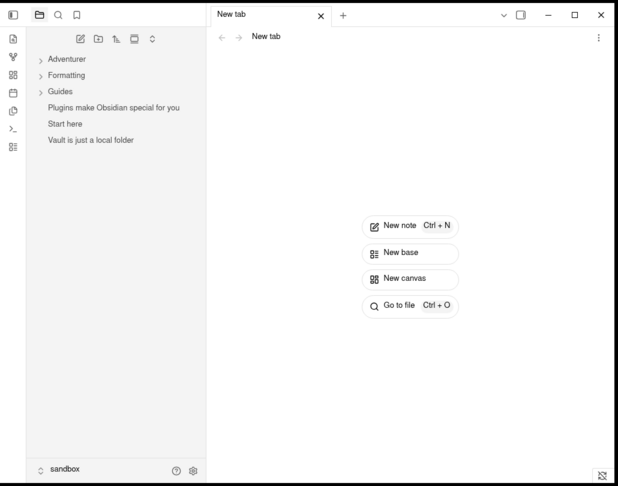
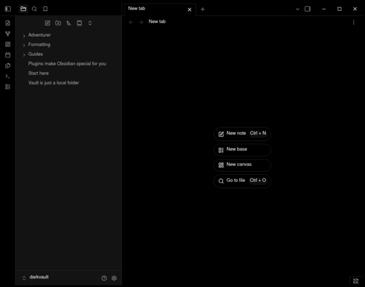

# Obsidian Clone — minimal monochrome rebuild for Linux

A from-source rebuild of the **Obsidian 1.15.0** desktop application for Linux,
rebuilt with a **minimal white/black monochrome theme**.

Every application feature is preserved. The rebuild changes exactly two things:

1. the colour system (a monochrome palette replaces Obsidian's default themes), and
2. the update channel (the upstream auto-updater is disabled, because an upstream
   update would replace the themed payload with the stock one).

```
original AppImage ──┐
                    ├──► payload (obsidian.asar) ──► + clone-theme.css ──► clone
official asar.gz ───┘             ▲
                                  │
                        launcher (app.asar) ──► patched: updater off,
                                                   optional isolated user data
```

---

## 1. What was reverse engineered

| Layer | Artefact | Result |
| --- | --- | --- |
| Bootstrap | `resources/app.asar` | 73 KB Electron launcher: registers the privileged `app://` scheme, loads the payload, downloads + RSA-verifies upstream updates (`dynaList.io` cert). |
| Application | `resources/obsidian.asar` | 24.5 MB payload: `main.js` (212 KB, Electron main process), `app.js` (3.3 MB, renderer), `app.css` (598 KB, full design system), `enhance.js`, `i18n.js`, `worker.js`, `starter.js`, `quicklook.js`, `lib/` (CodeMirror 6, MathJax, PDF.js, PixiJS, reveal.js, Prism, Turndown, Defuddle, Readability, i18next, moment, scrypt), `i18n/` (50 locales), `public/` (Inter + Source Code Pro fonts). |
| Runtime | `obsidian` ELF | Electron **43.8.4** / Chromium **150.0.7871.250**. |
| Renderer origin | `app://obsidian.md/` | All renderer assets are served from the payload through a custom privileged scheme. |

The reverse engineering was performed with [**REA**](https://github.com/morluto/rea)
(`rea-agents` 6.8.0):

```bash
npm install -g rea-agents

# static reconstruction of the whole Electron application
rea analyze-javascript-application ./extracted \
    --detail summary \
    --evidence_output ./rea-evidence/obsidian-js-app.evidence.json

# first-party sources only (the third-party CodeMirror bundle exceeds the
# per-source budget, so it is selected out explicitly)
rea analyze-javascript-application ./extracted \
    --source-paths-json sources.json \
    --analysis-timeout-ms 1200000 \
    --detail summary \
    --evidence_output ./rea-evidence/firstparty.evidence.json

# the clone itself, observed through REA's Electron provider
rea capture-electron-scenario scenario.json --format json
```

See [`docs/REPORT.md`](docs/REPORT.md) for the full findings, the evidence
inventory and the limits of the analysis.

---

## 2. The monochrome theme

| light variant | dark variant |
| --- | --- |
|  |  |

Both renders contain **zero** saturated pixels — only pure black, white and greys.

The theme lives in [`theme/clone-theme.css`](theme/clone-theme.css) and is linked
after Obsidian's own stylesheet in every HTML entry point
(`index.html`, `starter.html`, `help.html`).

It works on Obsidian's real design tokens rather than overriding individual
components:

* the whole `--color-base-00 … --color-base-100` ramp is replaced by a pure
  greyscale ramp, so every semantic token (`--background-primary`,
  `--text-normal`, `--background-modifier-border`, …) follows automatically;
* the accent colour is forced to pure black / pure white
  (`--accent-h/s/l`, `!important`, because Obsidian writes the user's accent
  choice as an inline style on `<body>`);
* shadows are removed, radii are reduced to 2–4 px, icons, tags, code, tables,
  callouts, menus, tooltips, graphs and canvas chrome are all recoloured;
* syntax highlighting is greyscale instead of multi-coloured.

Two palettes are shipped and both are strictly monochrome:

| Variant | Background | Text |
| --- | --- | --- |
| `light` | `#ffffff` | `#000000` |
| `dark`  | `#000000` | `#ffffff` |

`--variant=both` (default) keeps Obsidian's own light/dark setting and simply
makes *both* themes monochrome. `--variant=light` or `--variant=dark` pins one
palette for both theme classes.

---

## 3. Build

```bash
# 1. fetch the official release (nothing proprietary is stored in this repo)
scripts/fetch-sources.sh --version 1.15.0

# 2. build the clone
scripts/build.sh                      # -> clone/ (AppDir) + dist/ (.deb, .AppImage, .tar.gz)
scripts/build.sh --variant=dark       # pin the black palette
scripts/build.sh --skip-package       # AppDir only (fast)
```

### Outputs

| Artefact | Path |
| --- | --- |
| Portable AppDir | `clone/` |
| Debian package | `dist/obsidian-clone_1.15.0_amd64.deb` |
| AppImage | `dist/ObsidianClone-1.15.0.AppImage` |
| Tarball | `dist/obsidian-clone-1.15.0-linux-amd64.tar.gz` |

### Install

```bash
sudo apt install ./dist/obsidian-clone_1.15.0_amd64.deb
obsidian-clone
# or
chmod +x dist/ObsidianClone-1.15.0.AppImage && ./dist/ObsidianClone-1.15.0.AppImage
```

> The AppImage is assembled the same way `appimagetool` does it: the ELF runtime prefix of the
> official AppImage plus a freshly built squashfs. On systems without FUSE, run it with
> `APPIMAGE_EXTRACT_AND_RUN=1 ./ObsidianClone-1.15.0.AppImage`.

### Run from source tree

```bash
clone/obsidian --no-sandbox
```

---

## 4. Runtime switches

Both are implemented in the patched launcher and are honoured by the packaged
builds:

| Variable | Effect |
| --- | --- |
| `OBSIDIAN_CLONE_USER_DATA=/path` | Run against an isolated user-data directory, so the clone can live side by side with an official Obsidian installation. |
| `OBSIDIAN_CLONE_DISABLE_UPDATE=0` | Re-enable the upstream auto-updater (it would replace the themed payload with the stock one). Disabled by default. |

---

## 5. Verification

| Check | Result |
| --- | --- |
| Payload parity | `diff -rq` between the official payload and the clone payload: **only** `index.html`, `starter.html`, `help.html` differ (one added `<link>` each) plus the added `clone-theme.css`. Every other file is byte identical. |
| Bootstrap parity | The launcher differs only in `main.js` (the documented updater/user-data patch). |
| Launch | The clone boots under Electron 43.8.4, opens a vault, renders the ribbon, file explorer, tabs, editor and the 1.15 “New note / New base / New canvas / Go to file” launcher. |
| Update channel | `obsidian.log` shows *“Loaded main app package …”* and **no** update check — the updater is off. |
| Isolation | The clone wrote its whole profile into the isolated user-data directory, leaving the system profile untouched. |
| Token check | Computed styles read back over CDP from the running clone: `--background-primary: #ffffff`, `--text-normal: #000000`, `--color-accent: #000000`. |
| Runtime independence | The same payload renders identically on a stock Electron 43.8.4 runtime. |
| REA observation | `rea list-electron-targets` recorded the live renderer page `app://obsidian.md/index.html` (`Chrome/150.0.7871.250`, `Electron/43.8.4`). |

---

## 6. Repository layout

```
theme/clone-theme.css        the monochrome theme (the only visual change)
scripts/fetch-sources.sh     download + extract the official release
scripts/build.sh             build the clone (payload -> asar -> AppDir)
scripts/package.sh           .deb / .AppImage / .tar.gz
scripts/patch_launcher.py    the launcher patch (updater + isolated user data)
scripts/run-app.sh           run an AppDir under Xvfb and screenshot it
scripts/verify-theme.mjs     read the computed tokens back over CDP and assert monochrome
docs/REPORT.md               reverse-engineering report and evidence inventory
docs/evidence/               curated REA extracts (analysis summary, IPC channels)
```

### Verifying a running clone

```bash
# start the clone with a CDP port
clone/obsidian --no-sandbox --remote-debugging-port=9222 &

# assert the palette is monochrome (light and dark variants)
node scripts/verify-theme.mjs --cdp http://127.0.0.1:9222 --expect light
node scripts/verify-theme.mjs --cdp http://127.0.0.1:9222 --expect dark
```

Switching the vault to the dark palette is a configuration change, not a code change:

```json
// <vault>/.obsidian/appearance.json
{ "theme": "obsidian" }   // "obsidian" = dark, "moonstone" = light
```

Upstream artefacts (`original/`, `extracted/`, `launcher/`, `appimage-extract/`)
and build output (`clone/`, `build/`, `dist/`) are **not** committed: Obsidian's
application code is proprietary and the Electron runtime exceeds GitHub's file
size limit. `scripts/fetch-sources.sh` reproduces them on demand.

---

## 7. Legal

This repository contains only the tooling, the theme and the documentation.
Obsidian is proprietary software by Obsidian.md; its application code, assets,
fonts and Electron runtime are downloaded from the official release at build time
and are neither redistributed nor modified beyond the theme applied here. Obsidian
and the Obsidian logo are trademarks of Obsidian.md. This project is an
interoperability and personal-use study, not an official Obsidian build.
