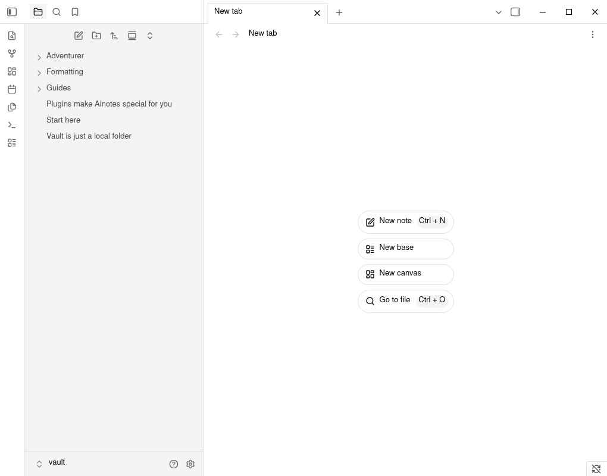
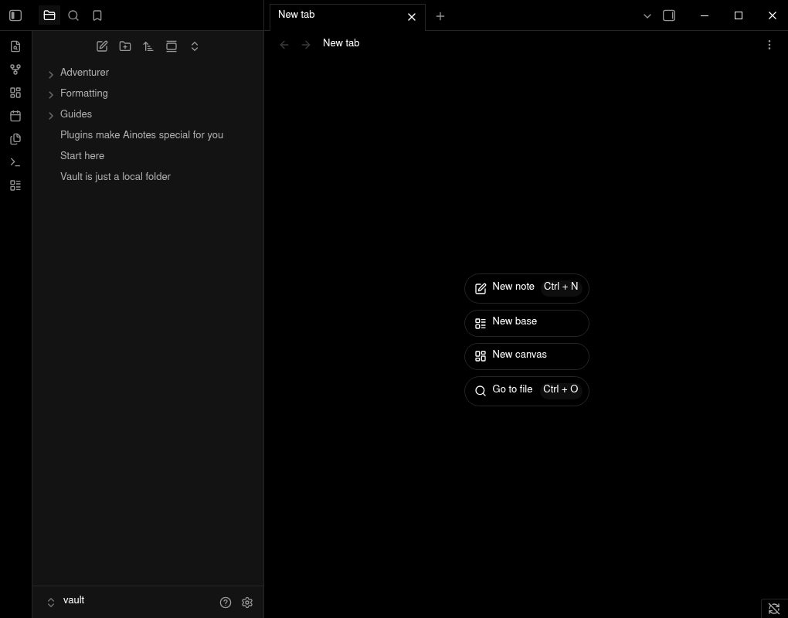

# Ainotes — minimal monochrome notes for Linux

Ainotes is a Linux desktop notes application with a **minimal white/black
monochrome theme**. It is assembled from a vendor application payload that is
downloaded at build time, then rebranded and themed by this repository.

Every application feature is preserved. The build changes three things:

1. **Identity** — the payload, launcher, runtime, packages, profile paths,
   URL scheme, MIME types, icons and sample vault are rebranded to Ainotes.
2. **Colour** — a monochrome palette replaces the stock light/dark themes.
3. **Update channel** — the self-updater is disabled by default, because an
   update would replace the themed payload with the stock one.

```
vendor AppImage ──┐
                  ├──► runtime + payload ──► rebrand ──► + monochrome theme ──► AppDir
vendor payload ───┘                                      ▲
                                                          │
                             launcher (app.asar) ─────────┘
                             patched: updater off, optional isolated data
```

| Light | Dark |
| --- | --- |
|  |  |

---

## 1. Build

```bash
# 1. fetch the vendor release (nothing proprietary is stored in this repo)
GITHUB_TOKEN=... scripts/fetch-sources.sh --version 1.15.0

# 2. build Ainotes
scripts/build.sh                      # -> ainotes/ (AppDir) + dist/
scripts/build.sh --variant=dark       # pin the black palette
scripts/build.sh --skip-package       # AppDir only (fast)
```

`GITHUB_TOKEN` is optional but recommended: the fetch script resolves the
release through GitHub's API, and an authenticated request avoids the
anonymous rate limit.

### Outputs

| Artefact | Path |
| --- | --- |
| Portable AppDir | `ainotes/` |
| Debian package | `dist/ainotes_1.15.0_amd64.deb` |
| AppImage | `dist/Ainotes-1.15.0.AppImage` |
| Tarball | `dist/ainotes-1.15.0-linux-amd64.tar.gz` |

### Install

```bash
sudo apt install ./dist/ainotes_1.15.0_amd64.deb
ainotes
# or
chmod +x dist/Ainotes-1.15.0.AppImage && ./dist/Ainotes-1.15.0.AppImage
```

The AppImage is assembled the same way `appimagetool` does it: the ELF runtime
prefix of the official AppImage plus a freshly built squashfs. On systems
without FUSE, run it with
`APPIMAGE_EXTRACT_AND_RUN=1 ./Ainotes-1.15.0.AppImage`.

### Run from the source tree

```bash
ainotes/ainotes --no-sandbox
```

---

## 2. Rebrand pipeline

The build keeps the fetched sources pristine and applies three deterministic
patchers to the build copy.

### Payload — `scripts/patch_payload.py`

Rewrites every text asset in the application payload (main process, renderer,
stylesheets, locales, HTML entry points, bundled libraries and the sample
vault) and renames any file or directory whose name carries the old brand.
The rewrite is mechanical, so every internal reference stays consistent:

* window and document titles, menus, About panel, settings text and locale
  strings;
* the `app://` renderer origin, the custom URL scheme, MIME types and the
  desktop-entry integration;
* the profile directory, vault registry, vault config directory and CLI
  socket/log paths;
* theme ids, editor CSS classes and the self-referential links in the sample
  vault.

### Launcher — `scripts/patch_launcher.py`

Patches the thin Electron bootstrap that loads the payload:

* disables the update path by default (`AINOTES_DISABLE_UPDATE=0` re-enables
  it);
* supports an isolated profile (`AINOTES_USER_DATA=/path`);
* disables LCD subpixel antialiasing, which would otherwise paint coloured
  fringes on glyph edges;
* rebrands the launcher package metadata and every remaining reference.

### Runtime — `scripts/patch_runtime.py`

Renames the Electron executable and CLI helper, rebuilds the desktop entry and
MIME database entry, replaces every icon size with the Ainotes icon, updates
the AppImage `AppRun` wrapper, and rewrites the CLI socket/message literals so
the helper and the payload agree.

### Theme — `theme/ainotes-theme.css`

The theme is linked after the application stylesheet in `index.html`,
`starter.html` and `help.html`. It works on the application's design tokens
rather than overriding individual components:

* the whole `--color-base-00 … --color-base-100` ramp is replaced by a pure
  greyscale ramp, so every semantic token follows automatically;
* the accent colour is forced to pure black or pure white;
* shadows are removed, radii are reduced to 2–4 px, and icons, tags, code,
  tables, callouts, menus, tooltips, graphs and canvas chrome are recoloured;
* syntax highlighting is greyscale instead of multi-coloured.

Two palettes are shipped and both are strictly monochrome:

| Variant | Background | Text |
| --- | --- | --- |
| `light` | `#ffffff` | `#000000` |
| `dark` | `#000000` | `#ffffff` |

`--variant=both` (default) keeps the application's own light/dark setting and
makes both themes monochrome. `--variant=light` or `--variant=dark` pins one
palette for both theme classes.

---

## 3. Verification

| Check | Result |
| --- | --- |
| Feature audit | **51/51** checks return a result on the running build (vault, file tree, core plugins, commands, settings, metadata cache, links, search, graph, canvas, bases, outline, switcher, properties, templates, daily notes, bookmarks, file explorer, page preview, word count, outgoing links, tags, note composer, command palette, file CRUD, link resolution, theme switching, editor, ribbon, monochrome DOM). |
| Monochrome tokens | `scripts/verify-theme.mjs` passes the light and dark palettes: pure `#ffffff`/`#000000` backgrounds and text, 0 % accent saturation, no shadows. |
| Brand scan | The extracted payload and launcher contain no case-insensitive upstream brand token. |
| Runtime identity | Window class `ainotes`/`Ainotes`, origin `app://ainotes.md`, profile `~/.config/ainotes`, vault config `.ainotes`, user agent `ainotes/1.15.0`. |
| Packaging | `.deb`, AppImage and tarball build; the AppImage squashfs offset is re-validated with `unsquashfs`. |

Run the audits against a live build:

```bash
# start Ainotes with a CDP port and a seeded vault
scripts/run-app.sh ainotes verify --vault /path/to/vault --seconds 25 \
  --args --remote-debugging-port=9222 &

node scripts/feature-audit.mjs --cdp http://127.0.0.1:9222
node scripts/verify-theme.mjs --cdp http://127.0.0.1:9222 --expect light
node scripts/verify-theme.mjs --cdp http://127.0.0.1:9222 --expect dark
```

The theme follows the application's theme setting; no code change is needed
to switch palettes.

---

## 4. Runtime switches

| Variable | Effect |
| --- | --- |
| `AINOTES_USER_DATA=/path` | Run against an isolated user-data directory. |
| `AINOTES_DISABLE_UPDATE=0` | Re-enable the update path (disabled by default). |

---

## 5. Repository layout

```
assets/ainotes.png             application icon
theme/ainotes-theme.css        the monochrome theme
scripts/fetch-sources.sh       download + extract the vendor release
scripts/patch_payload.py       rebrand every payload asset and path
scripts/patch_launcher.py      launcher patch (updater, isolated data, brand)
scripts/patch_runtime.py       rename runtime binaries, desktop entry, icons
scripts/build.sh               build the AppDir and packages
scripts/package.sh             .deb / .AppImage / .tar.gz
scripts/run-app.sh             run an AppDir under Xvfb and screenshot it
scripts/feature-audit.mjs      in-app feature battery over CDP
scripts/verify-theme.mjs       computed-token monochrome assertions
docs/ARCHITECTURE.md           build and runtime architecture
docs/screenshots/              light and dark renders
```

Fetched artefacts (`original/`, `extracted/`, `launcher/`,
`appimage-extract/`) and build output (`ainotes/`, `build/`, `dist/`) are not
committed.

---

## 6. Legal

This repository contains only the tooling, the theme, the icon and the
documentation (MIT licensed, see `LICENSE`). The application payload is
proprietary third-party software: it is downloaded from the vendor's public
release endpoint at build time, is not redistributed here, and is only
modified by the deterministic rebrand and theme steps described above.
Bundled third-party components inside that payload retain their own licences.
Use the build only with software you are licensed to run.
